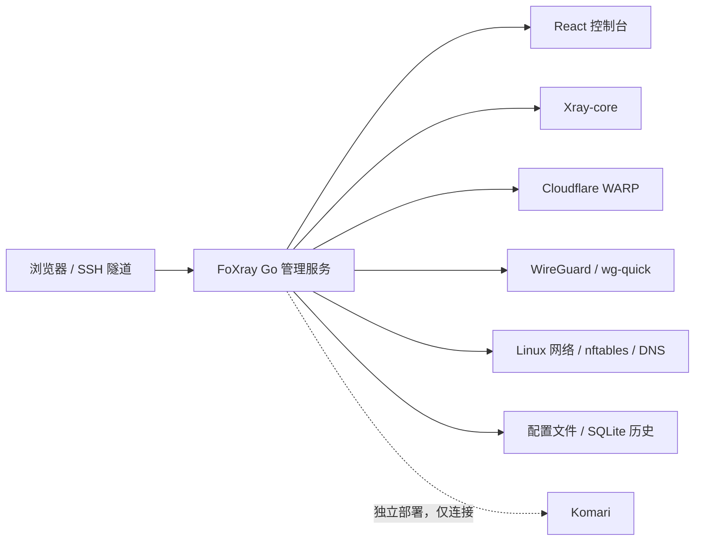

# FoXray Gateway v0.9.38 产品说明

## 产品定位

FoXray 是运行在自有 Linux 网关上的出口管理控制台，帮助管理员把代理出口、VPN 隧道、Linux 网络状态和监控数据放在同一工作流内。它适用于家庭实验室、个人网关及由单一信任域管理的小型网络。

它不是 Xray 协议核心，也不是面向用户售卖代理账号的订阅计费面板；不提供多租户、额度计费或内置 RBAC。与 3x-ui 等项目比较时，应比较场景与边界，而不是把界面相似视为能力完全相同。

## 组件关系

- FoXray 管理服务负责配置、任务、检测、采集和页面 API；管理程序升级可独立于转发组件进行。
- Xray 负责代理协议与转发。节点协议是否可用取决于所安装核心及本项目的导入、配置支持，不承诺上游所有协议参数均有界面入口。
- WARP 由 Cloudflare 官方客户端提供；候选端点扫描使用独立的 warpscout。Cloudflare 的可用性、账号资格和条款由其决定。
- WireGuard 依赖内核及工具包；外部管理接口和受保护对象不能被无条件接管。
- Komari 独立安装，FoXray 只配置连接入口和相关检查，不替代 Komari 服务。

## 使用流程

1. 部署并限制管理入口，检查已安装组件和现有转发是否兼容。
2. 添加节点或订阅，核对导入预览与启用状态。
3. 手动执行检测，查看评分依据、缺失项、延迟和上次测速时间。
4. 选择出口；启用自动检测/选优前确认检测频率、目标及故障回退策略。
5. 修改接口、路由或防火墙时先看计划，执行后核对状态并在确认窗口内确认。
6. 通过服务总览、监控和操作历史持续观察，定期备份并验证回退。

## 数据解释

监控分为后台采集、历史写入和页面刷新三个层次。缩短页面刷新不等于增加采样；提高历史密度不生成过去不存在的数据。状态点、缺测和连接数的含义见使用手册。

FoXray 不在缺少逐连接出口证据时按当前节点猜测业务连接归属；部分数据只能说明模块或接口总量。真连接检测、ICMP、测速和业务实时流量是不同测量，不能直接互相代替。

## 当前边界

| 项目 | v0.9.38 边界 |
| --- | --- |
| 发行二进制 | Linux amd64；源码与依赖可能支持其他架构，但未在本版发布同等验证的 arm64 包 |
| 完整部署验证 | Rocky Linux 10、systemd、nftables；发行包不等同于通用路由器固件 |
| 透明接管 | 默认识别 IPv4 出口接口和 LAN 网段，可在安装前检查并覆盖配置 |
| 包管理 | 安装器含 apt/dnf 依赖安装分支；部分组件更新依赖 dnf/rpm，不宣称 Debian 全功能已验证 |
| 管理入口 | HTTP API + 内网/回环来源限制；无内置登录、TLS、RBAC、多租户 |
| IPv6 | 部分读取和计划涉及 IPv6；不宣称端到端透明代理、SNAT和隧道策略完整支持 IPv6 |
| 容器 | 不提供经过验证的 Docker 一键部署，网络管理依赖宿主权限和 systemd |
| 可用性 | 单机管理工具，无集群控制平面和自动跨主机故障接管 |
| 自动化 | 版本检查不等于自动更新；网络变更与组件动作仍按相应确认机制执行 |
